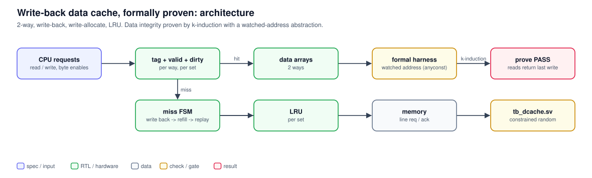
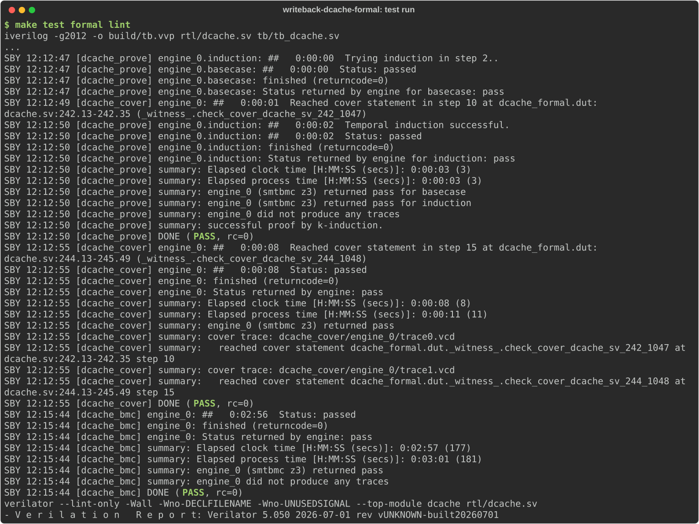

# Write-back data cache, formally proven

[](https://github.com/Ana2601/writeback-dcache-formal/actions/workflows/ci.yml)

2-way set-associative, write-back, write-allocate data cache with LRU replacement. Its data integrity is **proven** with SymbiYosys k-induction and also checked by constrained-random simulation.



## Design (`rtl/dcache.sv`)

- Parameterised: address/word width, words per line, sets
- Hit: response the next cycle. Miss sequence: `[write back dirty victim] → refill → replay`
- Byte-enable writes; dirty and valid bits per line; per-set LRU
- Whole-line memory interface with req/ack (any memory latency)

## Formal verification (`formal/`)

The backing store is abstracted with the **watched-address** technique: one arbitrary word address (`anyconst`) is modelled exactly, and every other line returns unconstrained data. Because the watched address can be anything, a proof for that word is a proof for every word.

**Property:** every read returns the most recently written value (the architectural value, as if there were no cache).

**Inductive invariants** that make it provable: the watched word is cached in at most one way; a cached copy equals the architectural value; when the line is not cached, or is cached clean, memory holds the architectural value; the miss FSM is consistent; and no set holds the same tag twice.

| Task | Result |
|---|---|
| `prove` (k-induction) | **PASS**: holds in every reachable state (about 4 s with z3) |
| `bmc` (16 cycles) | PASS |
| `cover` | write → evict (write-back) → refill → read-back witness found |
| Mutation check | removing the write-back makes the proof **fail**, so it is not vacuous |

## Simulation (`tb/tb_dcache.sv`)

64,000 random accesses (hot-set locality plus a conflict-heavy pattern, random byte strobes, random memory latency), then a read-back sweep of every word against a flat reference memory.

| Measured | |
|---|---|
| Reads checked | 44,109, **0 mismatches** |
| Hits / misses / write-backs | 29,904 / 34,192 / 13,145 (46.7 % hit rate, conflict-heavy by design) |

## Run

```bash
make test      # simulation
make formal    # bmc + prove + cover
make lint
```

## Test run

Output of the CI command (`make test formal lint`), captured from a local run:



## Limitations / next steps

Single outstanding miss (blocking), no coherence protocol (single core), no write buffer. The natural next step is a 2-core MSI snooping protocol, with a proof that two caches never hold the same line Modified.

## Setup

- [OSS CAD Suite](https://github.com/YosysHQ/oss-cad-suite-build) (Icarus Verilog, Verilator, Yosys, SymbiYosys)
- z3 (`brew install z3` / `apt install z3`)

```bash
make test
make formal
make lint
```

The same commands run in CI on every push (`.github/workflows/ci.yml`).
